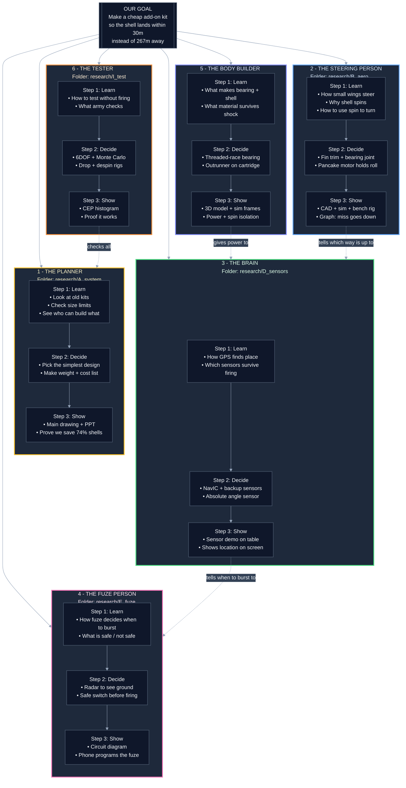

# SIH26098 — Low-Cost Precision Guidance & Smart Fuze for 155mm

**PS:** `SIH26098` | **Org:** Ministry of Defence / Yantra India Limited, Ambajhari | **Category:** Hardware | **Deadline:** 20 September 2026

> Development of a Low-Cost Precision Guidance and Smart Electronic Fuze System for a 155mm Artillery Shell (STANAG 2916, 39/45/52 cal - ATAGS/Dhanush/K9/M777)

---

## Design of Record — Clean-Sheet Track (Rev 1.1, 2026-08-30)

**CAD:** `cleansheet/PGK_CleanSheet.FCStd` — **native FreeCAD Assembly + 122-frame kinematic Simulation** (play in Assembly workbench → double-click `Simulations > Simulation` → Play)

**Docs:** `cleansheet/03_DESIGN_REPORT.md` (Rev 1.1, full design + §2.4 assembly) · `cleansheet/02_BOM_MANUFACTURING_ASSEMBLY.md` (Rev 1.1, BOM + fits + costing) · `cleansheet/00_REQUIREMENTS.md` · `cleansheet/HANDOFF.md` (Rev B, build provenance) · `cleansheet/scripts/` (gated `freecadcmd` builds)

> The **clean-sheet track is the analysis/design of record** that will be judged on architecture, physics and cost. The bench demonstrator below is a separate **exhibition artifact** (inert, low-speed, guarded) that shows the spin-isolation idea on a table. Do not present the bench model as the design.

### Architecture at a glance — three rotating frames

| Frame | Rotation | Members |
|---|---|---|
| **S — Shell** | ~250–267 rev/s (rifling-imposed) | shell body (M795-class, 696 mm, Ø154.9, 4.07-cal ogive), bearing outer ring (male 2-12UN-2A **full-depth well** z 606–696, 90 mm, 42 turns — 3.8× std engagement), core cartridge (Ø31.6 journal in Ø32 bore, pinned to outer ring via 4× Ø3 shear pins), stator + windings + Hall sensors, battery (1× 26500 NMC, 16.7 Wh, 45 A, 30× energy margin), ignitor interface |
| **R — Rotor / Canard** | motor-positioned at roll ψ (~0 absolute) | outrunner bell + magnet ring (24→12 poles planned, N42SH), one-piece machined canard shell (7075-T6, cap Ø89 + drum + **4 delta fins** tip Ø138, trimmed pair ±3° mirrored), pilot bearing, radome (GFRP, Ø84 × 49.6) + base ring + GNC board (STM32G474 + ICM-42688) + GNSS/NavIC patch + prox head |
| *balls Ø3 × 160 (10 rows × 16, Ø40 circle) between S and R = the de-spin joint* ||

**Steering:** rotor frame is roll-aimed so its fin-pair lift vector points at the miss vector; the 0°/180° pair deflects together (±3° mirrored) to command magnitude, 90°/270° rides neutral — pure radial force, zero side force.

**Actuator = de-spin + steer + harvest (one machine):** pancake outrunner K_T 0.0024 N·m/A (0.14 N·m peak @ 60 A for the 250→0 rev/s de-spin transient over ~10 s, regenerating 0.2–0.3 Wh; 0.05 N·m continuous for roll hold). Voltage-wall sized for 3.7 V bus at 1,571 rad/s relative.

**CAD verification:** `Assembly` (24 links) → `Joints` (GroundedJoint on shell + 21 Fixed + 2 Revolute `J_MotorRotor` / `J_RollDecouple`) → `Simulations > Simulation` (0–4 s, 30 fps, 122 frames, drives `3.1416*time` / `-1.0472*time` rad/s). Solver rc=0. Shell/canard/radome translucent in the saved view so the spinning rotor is visible.

**Mass & cost:** ~1.77 kg as-built → ~1.49 kg optimized (A1 thin-wall + Al bell, target ≤1.5 kg); ex-works ~₹0.7–0.9 L @1k units (8–12% of ₹8–11 L ceiling). See `02_BOM` §D–F.

> Full design, operation timeline (t=0 bore ride → t≈90 s fuze), subsystem details, physics audit and REQ register: `cleansheet/03_DESIGN_REPORT.md`.

---

## Frozen Team Baseline (for reference only)

<details>
<summary>Bench demonstrator + old CAD — click to expand</summary>

Detailed inert CAD envelope `PGK_155mm.FCStd` — shell-spin rotor hub → **single 61811 thin-section de-spin bearing** → Ø106 dome-nosed de-spun stator carrying **4 fixed strakes**, a **12-pole ring motor** (roll-torque steering + regen power), detent pawl + solenoid launch lock, Ø87 GNC PCB (2× STM32F405, ICM-42688, MMC-5983, FOC driver, dual Hall index), 6× 14430 battery bay, NEO-M9N + Ø25 patch under the dome. Kit envelope Ø148 × 168 mm. Superseded concepts are preserved under `legacy/old_two_motor_design/`. Performance and cost figures elsewhere are project targets or public reference points, not results.

**Bench demonstrator (exhibition artifact, not the design):** `cad_models/generate_pgk_155.py` + `cad_models/PGK_DEMO_ASSEMBLY.md` + `cad_models/render_pgk_155.py` (exports in `cad_models/out_pgk/`). Common four-canard carrier, coaxial front/rear display bearings, shell-to-carrier alternator/torque emulator — inert, low-speed, guarded. See `SIH26098_TEAM_BRIEFING.md` for the bench scope boundary.

</details>

### Quick Start for Team

0. **NEW? Read the briefing first:** `SIH26098_TEAM_BRIEFING.md` — PS breakdown, artillery 101, shell glossary, physics with formulas, subsystems, roles, video watchlist, 3-week plan. For the **design of record**, also read `cleansheet/03_DESIGN_REPORT.md` and open `cleansheet/PGK_CleanSheet.FCStd`. For the bench model, read `cad_models/PGK_DEMO_ASSEMBLY.md` and open the **Excalidraw board** (6 panels: problem → fix → mission → physics → anatomy → team).
1. **Clone:** `git clone https://github.com/jagathsrujan/sih26098-pgk-bharat.git`
2. **Pick your category** in `research/` (see table below)
3. **Read:** `SIH26098_Exhaustive_Ideas_Catalog.md` (108 ideas) + `SIH26098_Ideas_Database.json`
4. **Research:** Add `research/<category>/entry_YYYYMMDD_<topic>.md` using `research/templates/entry_template.md`
5. **Push:** `git add . && git commit -m "feat(B): piezo motor wind load test" && git push` → auto-updates `LIVEBOARD.md` + Notion

### Team Map — Who Does What (Simple View)

> **New here? Start here.** 3 Mech now + 3 ECE/CSE to hire. We all work towards the top goal. Each colored box = 1 person. Read top to bottom: **Learn → Decide → Show**.



**How to read for beginners:**
*   **Top black box = our shared goal.** Everything points there.
*   **Each colored box = one teammate.** You only need to understand your box — not all 6.
*   Inside each box, read top to bottom: **Step 1 Learn** (what to read), **Step 2 Decide** (what to choose), **Step 3 Show** (what you hand in).
*   Thin dotted lines = help between teammates. Example: Body Builder (5) must give power before Brain (3) can work.

> **Scared of hard words? Quick glossary:** `CEP` = how close to target (smaller is better) • `STANAG 2916` = standard screw size so it fits all guns • `Fuze` = the tiny computer on the nose that decides when to burst • `NavIC` = India's GPS

<details>
<summary>Need the full technical map (with codes like A1, B1, FMCW)? Click here</summary>

Technical version is in `SIH26098_Exhaustive_Ideas_Catalog.md` — same 6 boxes but with part numbers. Use this simple map to start, switch to technical after week 1.

</details>

### Quick Table (plain English)

| # | Role (simple name) | Folder | Learn About | Decide | Show At The End |
|---|-------------------|--------|-------------|--------|-----------------|
| 1 | The Planner | `A_system` | Old kits, size limits, who builds what | Simplest kit + cost | Main drawing, cost sheet, slides |
| 2 | The Steering Person | `B_aero` | Small wings, bearing joint, outrunner | Fin pair trim + bearing/motor | CAD sim frames, miss graph |
| 3 | The Brain | `D_sensors` | GPS + absolute angle sensor | NavIC + EKF, angle sensor carries roll | Sensor demo on table |
| 4 | The Fuze Person | `E_fuze` | When to burst, safe switch | Radar + S&A gating | Circuit, phone demo |
| 5 | The Body Builder | `F_power` | Threaded-race bearing, outrunner body | Bearing-in-well + pancake motor | 3D model + sim, power test |
| 6 | The Tester | `I_test` | How army tests | 6DOF + Monte Carlo + rigs | CEP histogram, proof |

### CAD Models

```bash
# Design of record — clean-sheet track (Rev 1.1)
open cleansheet/PGK_CleanSheet.FCStd          # FreeCAD 1.1.3 — Assembly (24 links, 23 joints, 122-frame Simulation) — see cleansheet/HANDOFF.md
# Bench demonstrator (exhibition artifact, separate)
cd cad_models
/Applications/FreeCAD.app/Contents/Resources/bin/freecadcmd render_pgk_155.py  # exports from cad_models/generate_pgk_155.py
python simulate_trajectory_155.py             # trajectory sim (3DOF → 6DOF, Monte Carlo)
```

- **Design of record:** `cleansheet/PGK_CleanSheet.FCStd` + `cleansheet/03_DESIGN_REPORT.md` (Rev 1.1, three-frame topology, 2.4 kinematic assembly, physics audit, REQ register) + `cleansheet/02_BOM_MANUFACTURING_ASSEMBLY.md` (Rev 1.1, BOM + fits + costing) + `cleansheet/HANDOFF.md` (Rev B, build provenance + how to play the Simulation)
- **Bench demonstrator (exhibition artifact):** `cad_models/generate_pgk_155.py` + `cad_models/PGK_DEMO_ASSEMBLY.md` + `cad_models/render_pgk_155.py` (exports in `cad_models/out_pgk/`)
- **Legacy only:** `legacy/old_two_motor_design/` (two N20 motors, face gears — superseded)

### Live Research Board

*   **GitHub:** `research/` folders + `SIH26098_LIVEBOARD.md` (auto-generated)
*   **Realtime:** Push → GitHub Action merges entries → Discord/Slack webhook
*   **AI Agents:** Each member runs same prompt in `research/templates/agent_prompt.md` via opencode/Perplexity

### Deliverables Checklist

- [x] System architecture doc — `cleansheet/03_DESIGN_REPORT.md` (Rev 1.1, three-frame topology, §2.4 Assembly)
- [x] CAD — `cleansheet/PGK_CleanSheet.FCStd` (native Assembly + Simulation, 24 links, 23 joints) + bench demonstrator in `cad_models/`
- [ ] GNC algorithm (PID/MPC/LSTM) — next: 6DOF + Monte Carlo
- [ ] 6DOF simulation + Monte Carlo CEP — roadmap `03_DESIGN_REPORT.md` §10
- [x] Prototype PoC — inert 3D print + guarded low-speed bench rig (bench demonstrator) + clean-sheet CAD sim frames
- [x] Cost + manufacturability — `02_BOM` Rev 1.1 (ex-works ~₹0.7–0.9 L @1k, 8–12% of ceiling, NRE ~₹4.2 Cr)

### References

*   `SIH2026_Hardware_PS.json:349` (Official PS)
*   `SIH26098_Exhaustive_Ideas_Catalog.md` (108 ideas, 30+ sources)
*   `SIH2026_Hardware_PS.md` / `SIH2026_Hardware_MECHANICAL.md`
*   `cleansheet/03_DESIGN_REPORT.md` · `cleansheet/02_BOM_MANUFACTURING_ASSEMBLY.md` · `cleansheet/HANDOFF.md`

