# SIH26098 — Low-Cost Precision Guidance & Smart Fuze for 155mm

**PS:** `SIH26098` | **Org:** Ministry of Defence / Yantra India Limited, Ambajhari | **Category:** Hardware | **Deadline:** 20 September 2026

> Development of a Low-Cost Precision Guidance and Smart Electronic Fuze System for a 155mm Artillery Shell (STANAG 2916, 39/45/52 cal - ATAGS/Dhanush/K9/M777)

**Target:** CEP ≤30m (stretch 10m), 74% logistics saving 301→77 shells, ₹8-11L/kit

### Quick Start for Team

1. **Clone:** `git clone https://github.com/jagathsrujan/sih26098-pgk-bharat.git`
2. **Pick your category** in `research/` (see table below)
3. **Read:** `SIH26098_Exhaustive_Ideas_Catalog.md` (108 ideas) + `SIH26098_Ideas_Database.json`
4. **Research:** Add `research/<category>/entry_YYYYMMDD_<topic>.md` using `research/templates/entry_template.md`
5. **Push:** `git add . && git commit -m "feat(B): piezo motor wind load test" && git push` → auto-updates `LIVEBOARD.md` + Notion

### Team Map — Who Researches What → Builds What → Delivers What

> 3 Mech now + 3 ECE/CSE to hire. Each box = one person. Follow your color: `Research` → `Come up with` → `Final Deliverable` (file it lands in).

```mermaid
flowchart TD
    GOAL[[SIH26098<br/>155mm PGK Kit<br/>CEP ≤30m • ₹8-11L • STANAG 2916<br/>YIL / ATAGS / M777]]

    subgraph M1 [1 — SYSTEM ARCHITECT / LEAD<br/>Mech+Systems • research/A_system + H_mfg]
        direction TB
        M1_R["🔍 RESEARCH<br/>A1-A12 kit architectures<br/>H1-H8 clean-sheet cost / SAMM AM<br/>STANAG 2916 220/124.7mm/770g<br/>YIL+MIL+BEL+ARDE chain"]
        M1_C["💡 COME UP WITH<br/>Baseline: A1 PGK-Clone<br/>SWaP budget + BoM ₹8-11L<br/>Trade: A1 vs A3 vs A4"]
        M1_D["📦 DELIVER<br/>Arch Doc A-J + Cost Sheet H1<br/>PPT: 267m→10m + 74% saving<br/>STANAG interface DWG"]
        M1_R --> M1_C --> M1_D
    end

    subgraph M2 [2 — AERODYNAMICS + GNC<br/>Aero/Mech • research/B_aero + C_gnc]
        direction TB
        M2_R["🔍 RESEARCH<br/>B1-B16 canard actuation<br/>B1 fixed canted -4/+4° + brake<br/>C10 PID / C11 MPC / C12 Glide"]
        M2_C["💡 COME UP WITH<br/>No-servo brake steering<br/>PID 20-line + MPC tuning<br/>B14 topology CFD @ Mach 0.8"]
        M2_D["📦 DELIVER<br/>simulate_trajectory_155.py<br/>Monte Carlo 1000-run CEP hist.<br/>CFD lift 0.30N·m Report I3"]
        M2_R --> M2_C --> M2_D
    end

    subgraph M3 [3 — EMBEDDED / FLIGHT COMPUTER<br/>ECE/CSE • research/C_gnc + D_sensors]
        direction TB
        M3_R["🔍 RESEARCH<br/>D1-D16 NavIC/GPS/IMU<br/>C3 GNSS-SDR NavIC L5 (2MSPS)<br/>C6 gyroless mag+acc / C7 LSTM"]
        M3_C["💡 COME UP WITH<br/>Dual GNSS board (STA8090/MeitY)<br/>LIS3MDL+HMC + MS5611 10cm<br/>LSTM <5m backup on STM32H7"]
        M3_D["📦 DELIVER<br/>STM32H7 bring-up + RTL-SDR fix<br/>ZED-F9P demo / D6 20kG IMU<br/>Sensor log + LSTM inference"]
        M3_R --> M3_C --> M3_D
    end

    subgraph M4 [4 — RF + FUZE ELECTRONICS<br/>ECE • research/E_fuze + D_sensors]
        direction TB
        M4_R["🔍 RESEARCH<br/>E1-E10 fuze modes<br/>E1 FMCW 24GHz 6/12/18m<br/>E8 MEMS S&A 15x17x5mm"]
        M4_C["💡 COME UP WITH<br/>FMCW 3s HOB + CW backup<br/>PD <250μs / 60ms delay<br/>J1 EPIAFS inductive coil"]
        M4_D["📦 DELIVER<br/>KiCad Block Diagram<br/>NFC Phone Setter J2 Demo<br/>Potted Fuze Bench E9/E10"]
        M4_R --> M4_C --> M4_D
    end

    subgraph M5 [5 — STRUCTURES + POWER<br/>Mech/Materials • research/F_power + G_structure]
        direction TB
        M5_R["🔍 RESEARCH<br/>F1-F10 power + G1-G10 mat.<br/>F1 super-cap+alternator 20yr<br/>G6 bearing 630 25kG / G3 Inconel718"]
        M5_C["💡 COME UP WITH<br/>F5 dual-use motor/brake<br/>Bearing shield + LPBF HIP<br/>G5 Dow 3140 potting + G8 radome"]
        M5_D["📦 DELIVER<br/>generate_pgk_155.py + shell<br/>Power bench <6s boot<br/>MIL-STD-331C Plan I4"]
        M5_R --> M5_C --> M5_D
    end

    subgraph M6 [6 — SIMULATION + INTEGRATION<br/>CSE/Mech • research/I_test + J_integration]
        direction TB
        M6_R["🔍 RESEARCH<br/>I1-I6 Test / J1-J6 Integration<br/>I2 PRESIMEN SDR HIL<br/>J3 ATAGS/Dhanush/K9 fire ctrl"]
        M6_C["💡 COME UP WITH<br/>HIL rig SiGe GN3S IQ<br/>Wind tunnel AoA 0-6°<br/>J5 telemetry + J6 modular bay"]
        M6_D["📦 DELIVER<br/>Lot Acceptance 41/42 97%<br/>Demo Rig + Drop Test I5<br/>LIVEBOARD + Final Video"]
        M6_R --> M6_C --> M6_D
    end

    GOAL --> M1 & M2 & M3 & M4 & M5 & M6

    M2_D -. feeds roll ref D12 .-> M3
    M5_D -. powers 6s .-> M3
    M3_D -. programs .-> M4
    M4_D -. HOB triggers .-> M6
    M1_D -. SWaP/cost gates .-> M5
    M6_D -. validates CEP .-> M1

    classDef lead fill:#fef3c7,stroke:#f59e0b,stroke-width:2px
    classDef aero fill:#dbeafe,stroke:#3b82f6,stroke-width:2px
    classDef emb fill:#dcfce7,stroke:#22c55e,stroke-width:2px
    classDef rf fill:#fce7f3,stroke:#ec4899,stroke-width:2px
    classDef str fill:#e0e7ff,stroke:#6366f1,stroke-width:2px
    classDef sim fill:#ffedd5,stroke:#f97316,stroke-width:2px

    class M1 lead
    class M2 aero
    class M3 emb
    class M4 rf
    class M5 str
    class M6 sim
```



**How to read:** `GOAL` at top → 6 parallel tracks. Each track: top = what you **research**, middle = what you **decide/build**, bottom = what file/demo you **deliver** for SIH judging. Dotted arrows = dependencies (e.g., Structures must power Embedded before it can log).

### Quick Table (same data)

| # | Role | Folder | Research About | Come Up With | Final Deliverable |
|---|------|--------|----------------|--------------|-------------------|
| 1 | System Architect / Lead | `A_system` + `H_mfg` | A1-A12 arch, H1-H8 cost, STANAG 2916, YIL chain | A1 baseline, 770g SWaP, ₹8-11L model | Arch Doc, PPT, cost sheet, interface DWG |
| 2 | Aerodynamics + GNC | `B_aero` + `C_gnc` | B1-B16 actuation, C10 PID, C11 MPC, B14 CFD | B1 brake steering, tuned PID/MPC | `simulate_trajectory_155.py`, CEP histogram, CFD report |
| 3 | Embedded / Flight Comp | `C_gnc` + `D_sensors` | D1-D16, C3 NavIC SDR, C6 gyroless, C7 LSTM | Dual GNSS + LSTM board | STM32H7 bring-up, RTL-SDR fix, sensor logs |
| 4 | RF + Fuze | `E_fuze` | E1-E10, FMCW 6/12/18m, E8 MEMS S&A, J1 EPIAFS | FMCW HOB + inductive setter | KiCad block, NFC J2 demo, potted bench |
| 5 | Structures + Power | `F_power` + `G_structure` | F1-F10, G1-G10, G6 bearing, G3 Inconel718 | F1 super-cap+alternator, bearing shield | `generate_pgk_155.py` + shell, power bench, MIL-STD-331 plan |
| 6 | Sim + Integration | `I_test` + `J_integration` | I1-I6, J1-J6, PRESIMEN HIL, ATAGS | HIL rig, telemetry, wind tunnel | Lot acceptance, demo rig, final video + LIVEBOARD |

### CAD Models

```bash
cd cad_models
python generate_shell_155.py   # 155mm inert mockup
python generate_pgk_155.py     # PGK nose module
python simulate_trajectory_155.py # 6DOF ballistic vs guided
```

### Live Research Board

*   **GitHub:** `research/` folders + `SIH26098_LIVEBOARD.md` (auto-generated)
*   **Realtime:** Push → GitHub Action merges entries → Discord/Slack webhook
*   **AI Agents:** Each member runs same prompt in `research/templates/agent_prompt.md` via opencode/Perplexity

### Deliverables Checklist

- [ ] System architecture doc (Categories A-J)
- [ ] CAD (FreeCAD/Fusion) + electronics block
- [ ] GNC algorithm (PID/MPC/LSTM)
- [ ] 6DOF simulation + Monte Carlo CEP
- [ ] Prototype PoC (3D print + despin rig)
- [ ] Cost + manufacturability (YIL forging, BEL electronics)

### References

*   `SIH2026_Hardware_PS.json:349` (Official PS)
*   `SIH26098_Exhaustive_Ideas_Catalog.md` (108 ideas, 30+ sources)
*   `SIH2026_Hardware_PS.md` / `SIH2026_Hardware_MECHANICAL.md`
