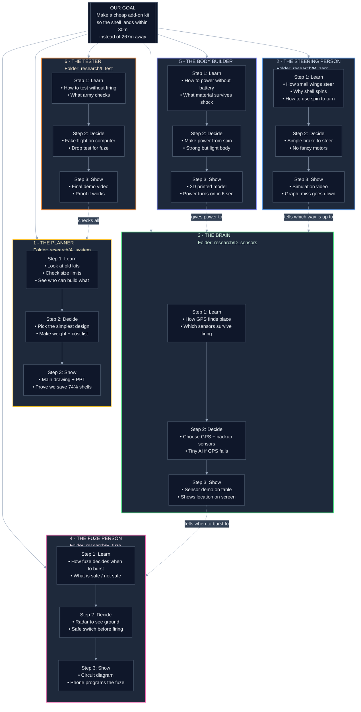

# SIH26098 — Low-Cost Precision Guidance & Smart Fuze for 155mm

**PS:** `SIH26098` | **Org:** Ministry of Defence / Yantra India Limited, Ambajhari | **Category:** Hardware | **Deadline:** 20 September 2026

> Development of a Low-Cost Precision Guidance and Smart Electronic Fuze System for a 155mm Artillery Shell (STANAG 2916, 39/45/52 cal - ATAGS/Dhanush/K9/M777)

> **⚠️ CURRENT DESIGN OF RECORD (2026-08-30):** the **clean-sheet track** — `cleansheet/PGK_CleanSheet.FCStd` (threaded-race bearing-in-well, pancake outrunner, roll-decoupled canard shell; native Assembly + kinematic Simulation included). Design docs: `cleansheet/03_DESIGN_REPORT.md` (Rev 1.1). Everything below describes the **frozen team baseline** and is kept for reference only.

**Current design baseline (FROZEN — see note above):** detailed inert CAD envelope `PGK_155mm.FCStd` — shell-spin rotor hub → **single 61811 thin-section de-spin bearing** → Ø106 dome-nosed de-spun stator carrying **4 fixed strakes**, a **12-pole ring motor** (roll-torque steering + regen power), detent pawl + solenoid launch lock, Ø87 GNC PCB (2× STM32F405, ICM-42688, MMC-5983, FOC driver, dual Hall index), 6× 14430 battery bay, NEO-M9N + Ø25 patch under the dome. Kit envelope Ø148 × 168 mm. Performance and cost figures elsewhere are project targets or public reference points, not results.

### Quick Start for Team

0. **NEW? Read the briefing first:** `SIH26098_TEAM_BRIEFING.md` — PS breakdown, artillery 101, shell glossary, physics with formulas, subsystems, roles, video watchlist, 3-week plan. For the active physical model, read `cad_models/PGK_DEMO_ASSEMBLY.md` and open the **Excalidraw board** (6 panels: problem → fix → mission → physics → anatomy → team).
1. **Clone:** `git clone https://github.com/jagathsrujan/sih26098-pgk-bharat.git`
2. **Pick your category** in `research/` (see table below)
3. **Read:** `SIH26098_Exhaustive_Ideas_Catalog.md` (108 ideas) + `SIH26098_Ideas_Database.json`
4. **Research:** Add `research/<category>/entry_YYYYMMDD_<topic>.md` using `research/templates/entry_template.md`
5. **Push:** `git add . && git commit -m "feat(B): piezo motor wind load test" && git push` → auto-updates `LIVEBOARD.md` + Notion

### Team Map — Who Does What (Simple View)

> **New here? Start here.** 3 Mech now + 3 ECE/CSE to hire. We all work towards the top goal. Each colored box = 1 person. Read top to bottom: **Learn → Decide → Show**.



**How to read for beginners:**
*   **Top black box = our shared goal.** Everything points there.
*   **Each colored box = one teammate.** You only need to understand your box — not all 6.
*   Inside each box, read top to bottom: **Step 1 Learn** (what to read), **Step 2 Decide** (what to choose), **Step 3 Show** (what you hand in).
*   Thin dotted lines = help between teammates. Example: Body Builder (5) must give power before Brain (3) can work.

> **Scared of hard words? Quick glossary:** `CEP` = how close to target (smaller is better) • `STANAG 2916` = standard screw size so it fits all guns • `Fuze` = the tiny computer on the nose that decides when to burst • `NavIC` = India's GPS

<details>
<summary>Need the full technical map (with codes like A1, B1, FMCW)? Click here</summary>

Technical version is in `SIH26098_Exhaustive_Ideas_Catalog.md` — same 6 boxes but with part numbers. Use this simple map to start, switch to technical after week 1.

</details>

### Quick Table (plain English)

| # | Role (simple name) | Folder | Learn About | Decide | Show At The End |
|---|-------------------|--------|-------------|--------|-----------------|
| 1 | The Planner | `A_system` | Old kits, size limits, who builds what | Simplest kit + cost | Main drawing, cost sheet, slides |
| 2 | The Steering Person | `B_aero` | Small wings, spin, brake | Simple steer, no motor | Simulation video, miss graph |
| 3 | The Brain | `D_sensors` | GPS + sensors | Best GPS + backup | Sensor demo on table |
| 4 | The Fuze Person | `E_fuze` | When to burst, safe switch | Radar + safe switch | Circuit, phone demo |
| 5 | The Body Builder | `F_power` | Battery-free power, strong cover | Spin-power + tough body | 3D model, power test |
| 6 | The Tester | `I_test` | How army tests | Fake flight + drop test | Demo video, proof |

### CAD Models

```bash
cd cad_models
/Applications/FreeCAD.app/Contents/Resources/bin/freecadcmd render_pgk_155.py  # exports + renders from common-carrier demo (cad_models/generate_pgk_155.py)
# Clean-sheet design of record (separate track): cleansheet/PGK_CleanSheet.FCStd — see cleansheet/03_DESIGN_REPORT.md
python simulate_trajectory_155.py                                                # trajectory sim (3DOF → 6DOF, Monte Carlo)
```

The bench demonstrator (`cad_models/generate_pgk_155.py` + `cad_models/PGK_DEMO_ASSEMBLY.md`) is a detailed inert envelope: shell-spin rotor hub, ONE 61811
thin-section de-spin bearing, dome-nosed de-spun stator with 4 fixed strakes,
12-pole ring motor (torque + regen), detent launch lock, Ø87 GNC PCB (2×
STM32F405, ICM-42688, MMC-5983, dual Hall), 6× 14430 bay, NEO-M9N + patch.
Superseded concepts are preserved under `legacy/`.

> **Clean-sheet design track:** `cleansheet/PGK_CleanSheet.FCStd` + `cleansheet/03_DESIGN_REPORT.md` (Rev 1.1) — threaded-race bearing-in-well, pancake outrunner, roll-decoupled canard shell. See `cleansheet/HANDOFF.md` for build provenance and how to play the 122-frame kinematic Simulation.

### Active model and legacy reference

- **Bench demonstrator (exhibition artifact):** `cad_models/generate_pgk_155.py` + `cad_models/PGK_DEMO_ASSEMBLY.md` + `cad_models/render_pgk_155.py` (exports in `cad_models/out_pgk/`)
- **Clean-sheet design of record:** `cleansheet/PGK_CleanSheet.FCStd` + `cleansheet/03_DESIGN_REPORT.md` (Rev 1.1) + `cleansheet/02_BOM_MANUFACTURING_ASSEMBLY.md`
- **Legacy only:** `legacy/old_two_motor_design/` (two N20 motors, face gears — superseded)

### Live Research Board

*   **GitHub:** `research/` folders + `SIH26098_LIVEBOARD.md` (auto-generated)
*   **Realtime:** Push → GitHub Action merges entries → Discord/Slack webhook
*   **AI Agents:** Each member runs same prompt in `research/templates/agent_prompt.md` via opencode/Perplexity

### Deliverables Checklist

- [ ] System architecture doc (Categories A-J)
- [ ] CAD (FreeCAD/Fusion) + electronics block
- [ ] GNC algorithm (PID/MPC/LSTM)
- [ ] 6DOF simulation + Monte Carlo CEP
- [ ] Prototype PoC (inert 3D print + guarded low-speed de-spin bench rig)
- [ ] Cost + manufacturability (YIL forging, BEL electronics)

### References

*   `SIH2026_Hardware_PS.json:349` (Official PS)
*   `SIH26098_Exhaustive_Ideas_Catalog.md` (108 ideas, 30+ sources)
*   `SIH2026_Hardware_PS.md` / `SIH2026_Hardware_MECHANICAL.md`
