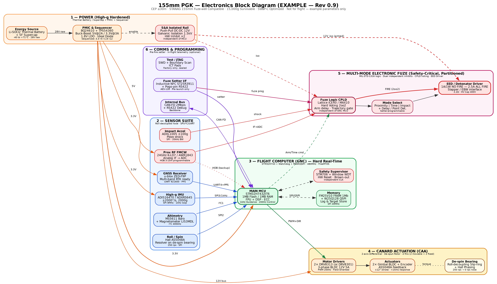

# 155mm PGK — Electronics Block Diagram — EXAMPLE OUTPUT (Rev 0.9)

> **This is an EXAMPLE only.** Real component selection / rails / interfaces to be frozen after you decide parameters. Generated 2026-08-31 as placeholder for `research/06_electronics-embedded-power` + `04` + `05` deliverables.

**Files in this folder:**
- `PGK_Electronics_BlockDiagram.png` — 300 DPI block diagram (this page)
- `PGK_Electronics_BlockDiagram.pdf` — vector PDF for report
- `PGK_Electronics_BlockDiagram.svg` — editable vector
- `PGK_Electronics_BlockDiagram.dot` — Graphviz source (edit & re-render)
- `BOM_example.csv` — example BOM for costing (not procured)
- `Interfaces_example.md` — bus / power / connector table



---

## 1. Why this partition (PS → KiCad mapping)

| PS Requirement | KiCad Block | Sheet |
|---|---|---|
| CAA for trajectory correction | **4 — CAA** drivers + actuators on de-spun nose | `04_CAA.kicad_sch` |
| GNC (CEP ≤30m) | **3 — Flight Computer** + **2 — Sensors** | `02_GNC.kicad_sch` + `03_SENSORS.kicad_sch` |
| Multi-mode Fuze (Prox/Time/Impact) | **5 — Fuze Logic + EED** (safety-partitioned, CPLD voting) | `05_FUZE.kicad_sch` |
| Embedded R/T + Power high-g + Comms | **1 — Power** + **6 — Comms/Setter** + **3 — MCU** | `01_PWR.kicad_sch` + `06_COMMS.kicad_sch` |

STANAG shell interface: circular Ø124mm, 6-layer rigid-flex stack, nose→base: `Fuze+S&A (nose tip) | Sensors | GNC | CAA + Bearing | Power (base, near threads)`.

---

## 2. Block Descriptions (example parts — tune later)

### 1 — POWER (orange, top)
- **Source:** Li-SOCl2 thermal battery (reserve type, activated by setback) + 5F supercap for peak CAA + EED. Survives 15,000g setback, -40 to +71°C.
- **PMIC:** `TPS54360` buck-boost → 5V@2A system, 3.3V@3A digital, 1.8V LDO. Sequencer: 3.3→5→1.8→12. Ideal diode + TVS.
- **S&A Rail:** Isolated push-pull 12V → fuze logic/EED. Galvanic 1.5kV, 2× series HW inhibits (independent of MCU, MIL-STD-1316). **Why isolated:** NO FIRE / ALL FIRE margin on EED.

### 2 — SENSOR SUITE (blue, middle-left)
All on de-spun section or buffered by bearing slip-ring.
- **IMU High-g:** `ADIS16470` (or `ADXRS645` gyro + `ADXL1005` piezo) — ±2000°/s, 2000g shock, SPI 8MHz, 1kHz EKF loop.
- **GNSS:** `u-blox ZED-F9P` multi-band, UART 921k6 + PPS → MCU, LNA+SAW in fuze well cap.
- **Baro+Mag:** `MS5611` (altimetry, 10cm res, I²C) + `LIS3MDL` mag for heading, I²C 400kHz.
- **Roll/Spin:** Hall AS5048A resolver on bearing → spin phase (250 rps shell → 0 rps nose). SPI2.
- **Impact sensor (fuze-red):** ADXL1005 ±100g piezo, 20kHz BW → Fuze CPLD directly (not via MCU).
- **Proximity RF FMCW:** 24GHz `K-LD7` or `AWR1843`, IF amp `OPA320` → ADC to CPLD; MCU sees HOB backup over dotted line. HOB 3-15m set by setter.

### 3 — FLIGHT COMPUTER / GNC (green, center)
- **MCU:** `STM32H743ZIT6` (480MHz, FPU+DSP, 1MB Flash/1MB RAM, ECC). 1kHz guidance, 200Hz inner loop ADRC/PID. FreeRTOS, dual-bank for in-flight A/B firmware.
- **Memory:** `FM25V10` FRAM (1Mb, SPI, 10¹⁴ cycles — logs) + `W25Q128` QSPI (trajectory/target).
- **Supervisor:** `STM706` window WDT + brown-out, independent RC osc → HW reset if MCU stalls. Safety gate between GNC time mode and Fuze.

### 4 — CAA (yellow, bottom)
- **Drivers:** 2× `DRV8313` (or `DRV8301`) 3-phase BLDC, 12V 5A, FOC, PWM 20kHz synchronized to roll.
- **Actuators:** 2× gimbal BLDC + `AS5048A` magnetic encoders, ±12° stroke, <15ms step (differential steering: 2 movable + 2 fixed fins per PS mech).
- **Bearing:** De-spin angular contact + slip-ring + Hall phasing (roll-decoupling).

### 5 — MULTI-MODE ELECTRONIC FUZE (red, right) — Safety-Critical, partitioned from GNC
- **CPLD:** Lattice `iCE40`/`MAX10`, 2oo2 voting, hard timers: arm delay (setback+sustained spin), trajectory gate, NO FIRE while safe.
- **Modes (setter-programmable):** Proximity (RF FMCW HOB), Time (RTC DS3231, ±2ppm), Impact (+ Delay 0-100ms / Point Det.). Selected via `fuz prog` line, not via GNC bus.
- **EED Driver:** 1A/1W NO FIRE — 2.5A ALL FIRE, EED 2.2Ω, HV cap 400V (slapper/EBW option for future). FIRE only when CPLD 2oo2 + MCU arm + traj gate + delay satisfied. **Dashed 12V_iso** = physically disconnected until safe separation.

### 6 — COMMS & PROGRAMMING (purple, top-middle)
- **Setter I/F:** Inductive `ST25R3911` NFC + pogo-pin RS422 (MAX3485), AES-128 pre-launch only. Programs fuze mode/HOB/time + target coordinates.
- **Internal Bus:** CAN-FD 2Mbps backbone (GNC ↔ setter ↔ fuze logic), RS422 debug.
- **Test/JTAG:** SWD + boundary-scan, ICT pads — sealed after factory ATP.

---

## 3. Power Rails (example)

| Rail | Source | Load | Peak | Notes |
|---|---|---|---|---|
| 3.3V | TPS54360 buck-boost | MCU, IMU, GNSS, mag/baro, FRAM, NFC | 3A | Sequenced first |
| 5V | same | RF IF, op-amps, encoders | 2A | — |
| 12V bus | same (boost) | CAA drivers | 5A pk | Bulk tantalum for 15k g |
| 12V_iso (S&A) | Isolated DCDC | CPLD + EED only | 1A | 2× series FET inhibits |

---

## 4. Buses & Timing

- **SPI:** IMU (SPI3 8MHz 1kHz), Impact (SPI 20kHz BW), Roll (SPI2)
- **I²C:** Baro/Mag (400kHz)
- **UART:** GNSS (921600 + PPS), Setter RS422
- **CAN-FD:** 2Mbps backbone
- **PWM:** 20kHz FOC to DRV8313

Control loop: `IMU 1kHz → EKF (quaternion) → Guidance (PN + bias comp) 100Hz → Roll-compensation → PWM 20kHz`.

---

## 5. KiCad Mapping (how this becomes schematics)

Each numbered cluster = one hierarchical sheet in KiCad 7/8:

```
PGK_GuidanceKit.kicad_pro
 ├─ 01_PWR.kicad_sch       (TPS54360, supercap, isol. DCDC)
 ├─ 02_SENSORS.kicad_sch   (IMU, GNSS, baro, mag, roll)
 ├─ 03_GNC.kicad_sch       (STM32H743, FRAM/QSPI, WDT)
 ├─ 04_CAA.kicad_sch       (DRV8313 x2, encoder)
 ├─ 05_FUZE.kicad_sch      (iCE40 CPLD, RF IF, ADXL1005, EED driver)
 └─ 06_COMMS.kicad_sch     (ST25R3911, CAN-FD, SWD)
 —Constraints: circular 124mm, 6L (1 signal /2 GND /3 Power /4 signal /5 GND /6 signal), IPC-2221B, ECSS.
```

After you lock parameters, run in KiCad MCP (write mode):
`kicad_create_new_project` → `sch_build_circuit` per sheet → `run_erc` → `pcb_set_board_outline` (circular) + `pcb_set_stackup` → `run_drc` → `export_gerbers`/`export_step`/`export_bom`.

Currently MCP is in `readonly` (verified `kicad_get_version` 10.0.6), so this example was rendered via Graphviz as stand-in for KiCad export.

---

## 6. What to decide for the REAL diagram

Tell me (one line each is enough):

1. GNSS: `ZED-F9P` vs cheaper `M10` / `LC29H`?
2. IMU: `ADIS16470` (SMT, $$ ) vs ST `ASM330LHHXA` (high-g, $)?
3. Proximity: 24GHz `K-LD7` discrete vs `AWR1843` SoC?
4. CAA motors: 2× gimbal BLDC vs 4× servo?
5. Power: thermal battery vendor / supercap size?
6. Setter: inductive NFC vs pogo RS422 vs both?
7. Board stack: 1-board vs 3-board flex stack (recommended 3 for SWaP-C)?

I’ll regenerate the KiCad-ready diagram + starter `.kicad_pro`/`.kicad_sch` + full BOM with Indian sourcing (YIL/BEL/ARDE) on your call.

---
*Example provenance: rendered from `PGK_Electronics_BlockDiagram.dot` (Graphviz 14.1.2). Inert/example — not for manufacture or flight safety analysis.*
